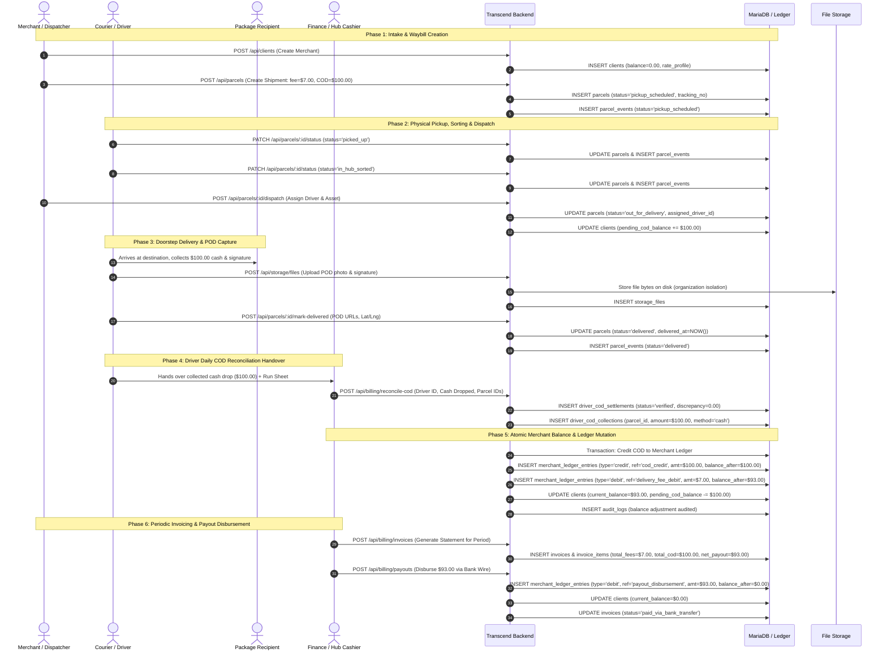
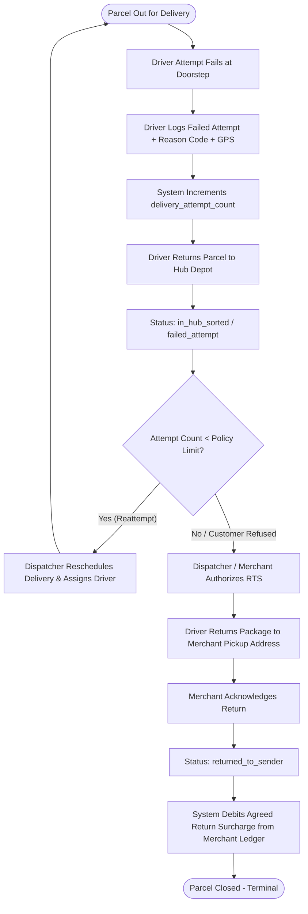
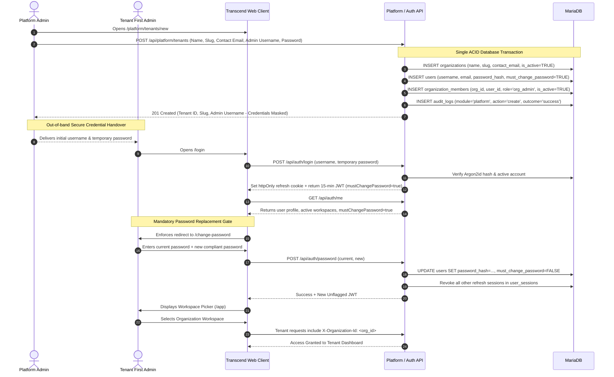
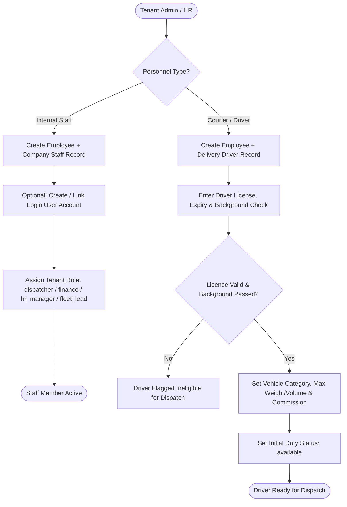
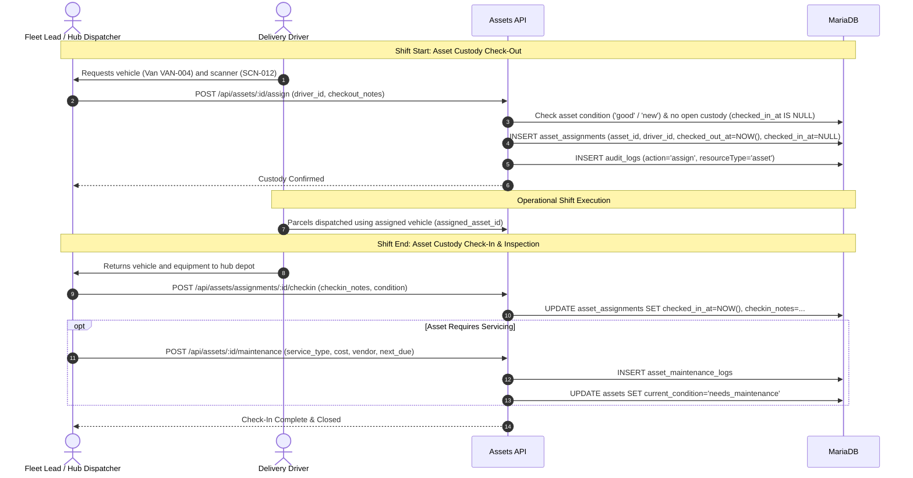
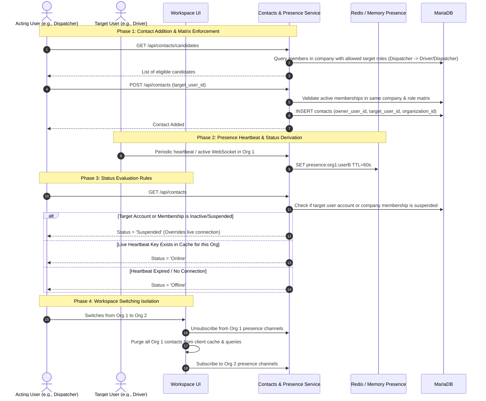

# Core User and System Flows

**Status:** Authoritative domain workflow specification synthesized from `.docs/` requirements, system architecture, database schema, and operational policies.

This document specifies the end-to-end **User Flows** (human operational journeys) and **System Flows** (system state machines, transaction boundaries, validations, ledger entries, and audit trails) across Transcend.

---

## Navigation & Flow Index

1. [Flow 1: Master Commercial & Cash-on-Delivery (COD) Lifecycle](#flow-1-master-commercial--cash-on-delivery-cod-lifecycle)
   - *Create Merchant → Create Shipment → Hub Intake & Dispatch → Delivery & POD → Driver COD Reconciliation → Merchant Ledger Balance Credit & Fee Debit → Invoicing → Payout Disbursement*
2. [Flow 2: Delivery Failure, Reattempt & Return to Sender (RTS) Lifecycle](#flow-2-delivery-failure-reattempt--return-to-sender-rts-lifecycle)
   - *Dispatch → Failed Attempt Recorded → Hub Return / Rescheduling → Multi-Attempt Evaluation → RTS Completion & Return Surcharges*
3. [Flow 3: Platform Provisioning & First Administrator Onboarding](#flow-3-platform-provisioning--first-administrator-onboarding)
   - *Platform Admin Onboards Tenant → First Admin Provisioning → Secure Handover → Workspace Picker → First Login Password Change*
4. [Flow 4: Tenant RBAC, Employee & Driver Qualification](#flow-4-tenant-rbac-employee--driver-qualification)
   - *Tenant User Creation → Personnel Record (Staff vs Driver) → Driver Compliance & Vehicle Pairing → Dispatch Availability*
5. [Flow 5: Fleet Custody Check-Out, Shift Tracking & Check-In](#flow-5-fleet-custody-check-out-shift-tracking--check-in)
   - *Asset Inventory → Shift Equipment Custody Check-out → Real-time Operation → Shift Check-in & Maintenance Logging*
6. [Flow 6: Company Contacts & Real-Time Presence Lifecycle](#flow-6-company-contacts--real-time-presence-lifecycle)
   - *Role Matrix Check → Add Contact → Transient Session Presence → Target Suspension Precedence → Workspace Switch Isolation*

---

## Flow 1: Master Commercial & Cash-on-Delivery (COD) Lifecycle

This is the primary commercial revenue and cash handling loop of Transcend. It connects the merchant's business with physical delivery execution, financial reconciliation, running balance accounting, and payout settlement.

### Detailed Phase Specifications

#### Step 1: Create Merchant Profile
* **Actor & Permission:** Dispatcher or Finance user with `clients.create`.
* **User Flow:**
  1. Actor navigates to `/app/clients` and clicks **New Client / Merchant**.
  2. Submits merchant legal name (`business_name`), scoped code (`client_code`, e.g., `MCH-001`), tax registration (`trade_license_no`), primary contact details (`contact_person_name`, `mobile_1`, `email`), billing address, and default pickup address with optional GPS coordinates.
  3. Selects pricing profile (`rate_profile_tier`, defaults to `'standard'`).
* **System Flow & Database Mutations:**
  1. Server checks active membership and verifies `clients.create`.
  2. Ensures `(organization_id, client_code)` is unique within the tenant.
  3. Inserts into `clients`:
     - `current_balance = 0.00`
     - `pending_cod_balance = 0.00`
     - `is_active = TRUE`
  4. Records `audit_logs` entry (`module = 'clients'`, `action = 'create'`, `resource_type = 'client'`).
  5. Returns sanitized client profile (omitting banking/restricted fields if caller lacks `clients.view_financials`).

#### Step 2: Create Shipment / Parcel Intake
* **Actor & Permission:** Dispatcher, Hub Staff, or Merchant user with `parcels.create`.
* **User Flow:**
  1. Actor navigates to `/app/parcels` and clicks **New Parcel**.
  2. Selects Merchant from directory.
  3. Enters recipient details: `recipient_name`, `recipient_phone`, `delivery_address`, `delivery_city_zone`, optional `delivery_landmark` and GPS coordinates.
  4. Specifies package dimensions: `weight_kg`, `length_cm`, `width_cm`, `height_cm`, `is_fragile`, and `package_type`.
  5. Specifies commercial terms: `delivery_fee` (service charge billed to merchant) and `cod_amount` (cash to collect at doorstep from recipient), optional `declared_value` and `is_insured`.
* **System Flow & Database Mutations:**
  1. Validates tracking number uniqueness (or auto-generates unique standard waybill number).
  2. Verifies that the referenced `client_id` belongs to the actor's verified `organization_id` and is active.
  3. Inserts into `parcels`:
     - `lifecycle_status = 'pickup_scheduled'` (or `'draft'` if saved without release)
     - `delivery_attempt_count = 0`
  4. Inserts initial milestone in `parcel_events`:
     - `status = 'pickup_scheduled'`
     - `actor_user_id = <request.user.id>`
     - `event_timestamp = CURRENT_TIMESTAMP`
  5. Records `audit_logs` entry.

#### Step 3: Hub Intake, Sorting & Dispatch Assignment
* **Actor & Permission:** Hub Sorter with `parcels.update_status`; Dispatcher with `parcels.dispatch` and `assets.assign`.
* **User Flow:**
  1. Driver picks up parcel from merchant; scans waybill → updates status to `picked_up`.
  2. Hub sorter receives parcel at depot; scans waybill → updates status to `in_hub_sorted`.
  3. Dispatcher opens Dispatch board (`/app/parcels/dispatch`), selects sorted parcels for Zone X, selects eligible Driver (must be `active`, license valid, background checked, duty status `available`), and assigns active vehicle (`assets`).
  4. Clicks **Dispatch Run Sheet** → Status moves to `out_for_delivery`.
* **System Flow & Database Mutations:**
  1. Verifies same-organization ownership for parcel, driver (`delivery_drivers.employee_id`), and asset (`assets.id`).
  2. Confirms driver's `dispatch_status` is eligible (`available` or `on_pickup`).
  3. Atomic Transaction:
     - Updates `parcels`:
       - `lifecycle_status = 'out_for_delivery'`
       - `assigned_driver_id = <driver_id>`
       - `assigned_asset_id = <asset_id>`
     - Inserts `parcel_events` (`status = 'out_for_delivery'`).
     - Updates `clients` table: increments `pending_cod_balance` by `parcels.cod_amount` (tracking unreconciled cash exposure in transit).
     - Updates `delivery_drivers`: optionally sets `dispatch_status = 'out_for_delivery'`.
     - Writes `audit_logs` record.

#### Step 4: Doorstep Delivery Execution & Proof of Delivery (POD)
* **Actor & Permission:** Courier / Driver with `parcels.mark_delivered`.
* **User Flow:**
  1. Driver arrives at recipient location, hands package, and collects Cash on Delivery (`$100.00`).
  2. Recipient signs on mobile app; driver snaps doorstep/package photo.
  3. Driver taps **Confirm Delivery**.
* **System Flow & Database Mutations:**
  1. Mobile app uploads signature and photo to `POST /api/storage/files`:
     - Stored on disk under `STORAGE_DIR/<organization_id>/<uuid>`.
     - Inserts `storage_files` row, generating file references.
  2. Driver app calls `POST /api/parcels/:id/mark-delivered` with:
     - `doorstep_photo_url` / storage file ID
     - `recipient_signature_url` / storage file ID
     - `delivered_latitude`, `delivered_longitude`
     - `amount_collected` (verifying full or partial COD collected)
  3. Atomic Transaction:
     - Validates current parcel status is `out_for_delivery` and caller is the assigned driver.
     - Updates `parcels`:
       - `lifecycle_status = 'delivered'`
       - `delivered_at = CURRENT_TIMESTAMP`
       - `recipient_signature_url = <url>`
       - `doorstep_photo_url = <url>`
       - `delivered_latitude = <lat>`, `delivered_longitude = <lng>`
     - Inserts `parcel_events` (`status = 'delivered'`, notes with collection summary).
     - Audits state transition in `audit_logs`.
  4. *Crucial Rule:* Marking a parcel `delivered` records physical drop-off and collected evidence. It **does NOT** immediately credit the merchant's available bank balance. Cash must first be physically handed over and reconciled by hub finance.

#### Step 5: Driver Daily COD Reconciliation & Handover
* **Actor & Permission:** Hub Cashier / Finance with `billing.reconcile_cod`.
* **User Flow:**
  1. At end of shift, Driver returns to hub with collected cash envelopes.
  2. Finance cashier opens `/app/billing` → **Driver COD Reconciliation**.
  3. Cashier selects Driver. System computes expected cash: $\sum \text{cod\_amount}$ across all parcels delivered by this driver during the shift.
  4. Cashier counts physical cash dropped by driver (e.g. `$100.00`), enters `total_cash_dropped`, selects collection method (`cash`, `pos_card`, `qr_transfer`), and clicks **Verify & Reconcile Handover**.
* **System Flow & Database Mutations:**
  1. Server calculates `discrepancy_amount = total_cash_dropped - total_cod_expected`.
  2. If discrepancy is within allowed policy ($0.00), marks status `'verified'`. If discrepancy exists, marks `'discrepancy_flagged'` and records cashier notes.
  3. Atomic Database Transaction:
     - Inserts into `driver_cod_settlements`:
       - `organization_id = <org_id>`
       - `settlement_reference = 'SETTLE-<UUID/CODE>'`
       - `driver_id = <driver_id>`
       - `reconciled_by_user_id = <finance_user_id>`
       - `total_cod_expected = 100.00`
       - `total_cash_dropped = 100.00`
       - `discrepancy_amount = 0.00`
       - `settlement_status = 'verified'`
       - `settled_at = CURRENT_TIMESTAMP`
     - For each delivered parcel in this sheet, inserts into `driver_cod_collections`:
       - `settlement_id = <settlement.id>`
       - `parcel_id = <parcel.id>`
       - `amount_collected = 100.00`
       - `payment_method = 'cash'`
     - **Merchant Balance Ledger Posting (Atomic Execution):**
       - Acquires pessimistic lock on `clients` row (`SELECT ... FOR UPDATE`).
       - Calculates previous balance $B = \text{clients.current\_balance}$ (e.g. `0.00`).
       - **Credit 1: Verified COD Collection**
         - Amount $A_{\text{cod}} = 100.00$
         - Balance after $B_1 = B + 100.00 = 100.00$
         - Inserts `merchant_ledger_entries`:
           - `client_id = <client.id>`
           - `reference_type = 'cod_credit'`
           - `reference_id = <collection.id>`
           - `entry_type = 'credit'`
           - `amount = 100.00`
           - `balance_after = 100.00`
           - `description = 'COD collected for parcel TRK-...'`
       - **Debit 2: Delivery Fee Charge**
         - Amount $A_{\text{fee}} = 7.00$
         - Balance after $B_2 = B_1 - 7.00 = 93.00$
         - Inserts `merchant_ledger_entries`:
           - `client_id = <client.id>`
           - `reference_type = 'delivery_fee_debit'`
           - `reference_id = <parcel.id>`
           - `entry_type = 'debit'`
           - `amount = 7.00`
           - `balance_after = 93.00`
           - `description = 'Delivery service fee for parcel TRK-...'`
       - Updates `clients` record:
         - `current_balance = 93.00`
         - `pending_cod_balance = pending_cod_balance - 100.00`
     - Inserts structured `audit_logs` entry capturing financial movement.

#### Step 6: Billing Statement Generation & Invoicing
* **Actor & Permission:** Finance Manager with `billing.create_invoice`.
* **User Flow:**
  1. At weekly or monthly closing, Finance navigates to `/app/billing/invoices` and clicks **Generate Merchant Invoices**.
  2. Selects Merchant and billing date range (e.g., Oct 1 to Oct 31).
  3. System aggregates all delivered shipments during the period.
  4. Finance reviews summary: Delivery charges ($7.00), COD Collected ($100.00), Net Balance ($93.00 net payout to merchant).
  5. Clicks **Issue Invoice**.
* **System Flow & Database Mutations:**
  1. Inserts into `invoices`:
     - `invoice_number = 'INV-2026-XXXX'`
     - `client_id = <client.id>`
     - `billing_period_start`, `billing_period_end`
     - `total_deliveries = 1`
     - `total_delivery_fees = 7.00`
     - `total_cod_collected = 100.00`
     - `net_amount_due = 93.00` (positive represents net payable to merchant)
     - `status = 'issued'`
     - `issue_date = CURRENT_DATE`, `due_date = CURRENT_DATE + 14`
  2. Inserts line items into `invoice_items`:
     - `invoice_id = <invoice.id>`
     - `parcel_id = <parcel.id>`
     - `delivery_fee = 7.00`
     - `cod_amount = 100.00`
     - `surcharges = 0.00`
     - `net_item_amount = 93.00`
  3. Audits invoice issue in `audit_logs`.

#### Step 7: Merchant Settlement & Payout Disbursement
* **Actor & Permission:** Finance Manager with `billing.adjust_balance`.
* **User Flow:**
  1. Finance initiates bank transfer of `$93.00` to merchant's registered bank account / IBAN.
  2. Upon bank confirmation, Finance opens the merchant ledger or invoice in `/app/billing` and clicks **Record Payout Disbursement**.
  3. Enters payment reference (e.g. `WIRE-9872134`), selects amount `$93.00`.
* **System Flow & Database Mutations:**
  1. Locks `clients` row (`SELECT ... FOR UPDATE`).
  2. Computes balance after: $B_{\text{new}} = 93.00 - 93.00 = 0.00$.
  3. Inserts into `merchant_ledger_entries`:
     - `client_id = <client.id>`
     - `reference_type = 'payout_disbursement'`
     - `reference_id = <invoice.id>`
     - `entry_type = 'debit'`
     - `amount = 93.00`
     - `balance_after = 0.00`
     - `description = 'Payout disbursement via Wire Ref: WIRE-9872134'`
  4. Updates `clients`: `current_balance = 0.00`.
  5. Updates `invoices`: `status = 'paid_via_bank_transfer'` (or `'paid_via_balance_offset'`).
  6. Writes `audit_logs` record.

---

## Flow 2: Delivery Failure, Reattempt & Return to Sender (RTS) Lifecycle

Deliveries often encounter real-world obstacles (recipient not home, wrong phone number, damaged goods, customer refused payment). This flow governs how exceptions, re-attempts, and returns are tracked and billed.

### Detailed Exception Steps

#### Step 1: Doorstep Delivery Failure
* **Actor & Permission:** Assigned Driver with `parcels.update_status`.
* **User Flow:**
  1. Driver cannot complete delivery (e.g. customer unavailable, wrong address, rejected cash payment).
  2. Driver opens mobile parcel view, clicks **Report Delivery Issue**.
  3. Selects standard `failed_reason_code` (e.g., `'customer_unavailable'`, `'refused_payment'`, `'incorrect_address'`, `'customer_rescheduled'`). Enters mandatory explanation notes.
  4. Submits failure report.
* **System Flow & Database Mutations:**
  1. Verifies caller is currently assigned driver and parcel is `out_for_delivery`.
  2. Atomic Transaction:
     - Updates `parcels`:
       - `lifecycle_status = 'failed_attempt'`
       - `delivery_attempt_count = delivery_attempt_count + 1`
       - `failed_reason_code = <reason_code>`
     - Inserts `parcel_events`:
       - `status = 'failed_attempt'`
       - `notes = <driver_notes>`
       - `actor_user_id = <driver.user_id>`
     - Does **not** modify merchant balance or post COD credit.

#### Step 2: Hub Check-In & Reattempt Routing
* **Actor & Permission:** Hub Sorter / Dispatcher with `parcels.update_status` and `parcels.dispatch`.
* **System Invariant:** A parcel with `failed_attempt` cannot immediately re-enter `out_for_delivery` without hub physical check-in or dispatcher re-authorization.
* **Workflow:**
  1. Package returned to hub depot at end of shift. Hub sorter scans package into inventory (`status = 'in_hub_sorted'`).
  2. If `delivery_attempt_count < 3` (standard company retry threshold):
     - Dispatcher coordinates with recipient/merchant for a convenient delivery window.
     - Dispatcher reassigns to driver → parcel transitions from `failed_attempt` / `in_hub_sorted` back to `out_for_delivery`.

#### Step 3: Return to Sender (RTS) Execution & Financial Accounting
* **Actor & Permission:** Dispatcher with `parcels.update_status`; Finance with `billing.adjust_balance`.
* **Trigger:** Parcel exceeds maximum attempt limit (e.g. 3 failed attempts) OR recipient explicitly cancelled/refused delivery.
* **Workflow:**
  1. Dispatcher marks parcel for return.
  2. Courier returns parcel to merchant's `default_pickup_address`.
  3. Merchant signs acknowledgment of returned goods.
  4. Courier/Dispatcher records completion → updates `parcels.lifecycle_status = 'returned_to_sender'` (terminal state).
  5. Inserts `parcel_events` (`status = 'returned_to_sender'`).
* **Financial Accounting for Returns:**
  - `cod_amount` is cancelled/voided. No COD credit is ever posted.
  - Pending COD balance is decremented: `pending_cod_balance = pending_cod_balance - cod_amount`.
  - Service fee handling follows merchant contract:
    - Base `delivery_fee` remains charged (service was rendered).
    - If return fee surcharge is agreed (e.g. 50% of delivery fee), an additional debit is posted:
      - Inserts `merchant_ledger_entries` (`reference_type = 'delivery_fee_debit'`, `entry_type = 'debit'`, `amount = return_surcharge`).
      - Atomically updates `clients.current_balance = current_balance - return_surcharge`.

---

## Flow 3: Platform Provisioning & First Administrator Onboarding

Transcend enforces strict multi-tenant isolation. Tenants (courier companies) cannot self-register through public forms. They are provisioned by Platform Administrators.

### Key Security & Transaction Rules
1. **Atomic Invariant:** An organization without an active administrator is an invalid system state. The `organizations`, `users`, `organization_members` (`role_id` = `org_admin`), and platform audit row must commit together in one transaction. If any step fails (e.g. duplicate slug or duplicate email), the entire transaction rolls back.
2. **Global Authority Separation:** Assigning `org_admin` inside `organization_members` grants tenant-scoped administrative rights. It **never** writes to `user_roles` (which reserves platform administration).
3. **Password Security:** Initial credentials are hashed using Argon2id. Passwords never appear in server logs, API responses, or audit records.

---

## Flow 4: Tenant RBAC, Employee & Driver Qualification

Once the tenant administrator enters the workspace, they onboard company personnel (office staff and couriers).

### User & System Steps

#### Step 1: Create Employee Base Profile
* **Actor & Permission:** HR Manager or Tenant Admin with `staff.manage` or `drivers.manage`.
* **Inputs:** Legal name, national ID, date of birth, personal mobile, residential address, emergency contact, `employment_classification` (`full_time`, `contractor`, etc.), and `compensation_type`.
* **System Mutation:** Inserts into `employees` table with unique `employee_code` scoped to `organization_id`.

#### Step 2: Branch into Personnel Specialization
* **Case A: Internal Staff:**
  - Inserts into `company_staff` (`employee_id`, `job_title`, `assigned_office_hub`, `reporting_manager_id`).
  - If system login is required: Tenant Admin calls `POST /api/members` (`admin.manage_users`) to create login credentials with appropriate role (`dispatcher`, `finance`, etc.) and links `employees.user_id = users.id`.
* **Case B: Delivery Driver:**
  - Inserts into `delivery_drivers` (`employee_id`, `driver_category`, `fleet_arrangement`, `license_number`, `license_class`, `license_expiry_date`, `background_check_passed`, `commission_per_drop`, `max_weight_capacity_kg`, `max_volume_capacity_m3`).
  - Driver duty status defaults to `'off_duty'`.

#### Step 3: Driver Dispatch Qualification Guard
* Before any driver can be assigned parcels in `parcels.dispatch`:
  - `background_check_passed` must be `TRUE`.
  - `license_expiry_date >= CURRENT_DATE`.
  - `employment_status` must be `'active'`.
  - `dispatch_status` must be `'available'` or `'on_pickup'`.

---

## Flow 5: Fleet Custody Check-Out, Shift Tracking & Check-In

Physical transport assets (motorcycles, delivery vans) and hardware assets (thermal bags, handheld barcode scanners, mobile POS terminals) are tracked via explicit custody check-out/check-in logs.

### Invariants
1. **Single Open Custodian (FLT-04):** An asset can have at most one active assignment where `checked_in_at IS NULL`. Checking out an asset that is currently checked out must be rejected with a `409 Conflict`.
2. **Decommissioned Asset Guard (FLT-05):** Assets marked `needs_maintenance` or `decommissioned` cannot be checked out or assigned to parcels.

---

## Flow 6: Company Contacts & Real-Time Presence Lifecycle

Transcend allows company members to establish intra-company contact relationships and view real-time presence.

### Presence & Isolation Rules
1. **Exactly Three Statuses:** `Online`, `Offline`, `Suspended`.
2. **Suspension Priority:** If a target's user account or tenant membership is deactivated, their status **must immediately evaluate to `Suspended`**, regardless of whether an open socket or cached token exists.
3. **Workspace Isolation:** An account active in Company A is not shown as `Online` in Company B unless they have an active connection explicitly established in Company B. Switching companies clears all contact caches, queries, and channel subscriptions immediately.

---

## Complete Business Invariants Summary Table

| Domain | Entity | Invariant Rule | Enforced By |
| --- | --- | --- | --- |
| **Tenant** | `organizations` | Every tenant must have at least one active `org_admin` at all times | Database transaction during creation; row locks on admin revoke |
| **Merchant** | `clients` | `(organization_id, client_code)` is strictly unique | MariaDB unique constraint `uq_org_client_code` |
| **Shipment** | `parcels` | Tracking number is globally unique; belongs to exactly one merchant and company | MariaDB unique constraint on `tracking_number` |
| **Dispatch** | `parcels` | Driver and vehicle must belong to same company and be compliant | Application service validations before state transition |
| **Evidence** | `storage_files` | POD photos and signatures stored with organization-scoped disk paths | `StorageService` file path generation and permissions guard |
| **Finance** | `driver_cod_settlements` | Each delivered parcel can be reconciled in at most one COD settlement sheet | MariaDB unique constraint on `driver_cod_collections.parcel_id` |
| **Ledger** | `merchant_ledger_entries` | Balance update and ledger journal entry must commit together in one transaction | Database transaction with pessimistic row lock on `clients` |
| **Precision** | Financial fields | Currency must use exact `DECIMAL(12,2)` arithmetic without floating-point drift | Database schema column type + BigNumber / exact string math |
| **Audit** | `audit_logs` | Audit trail is append-only; update/delete prevented before `retain_until` | Database triggers rejecting `UPDATE` and premature `DELETE` |
| **Presence** | Contacts | Contacts visible only to owning user within same verified company | Scoped SQL query predicates + presence cache key isolation |

