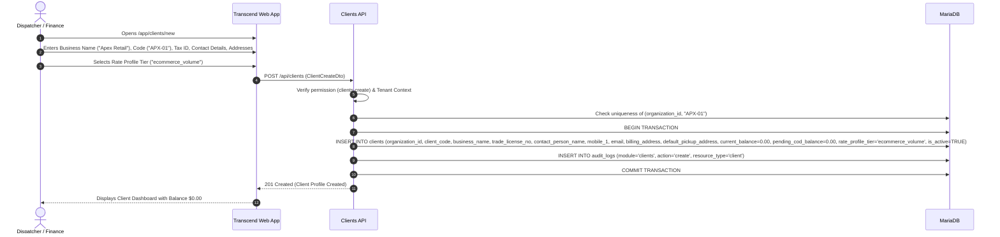
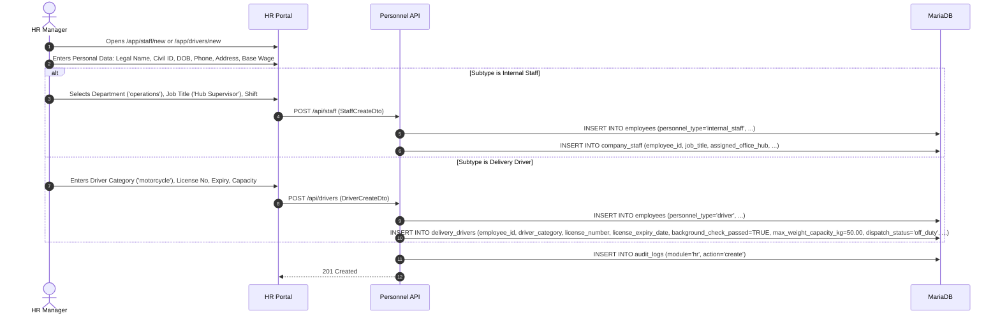
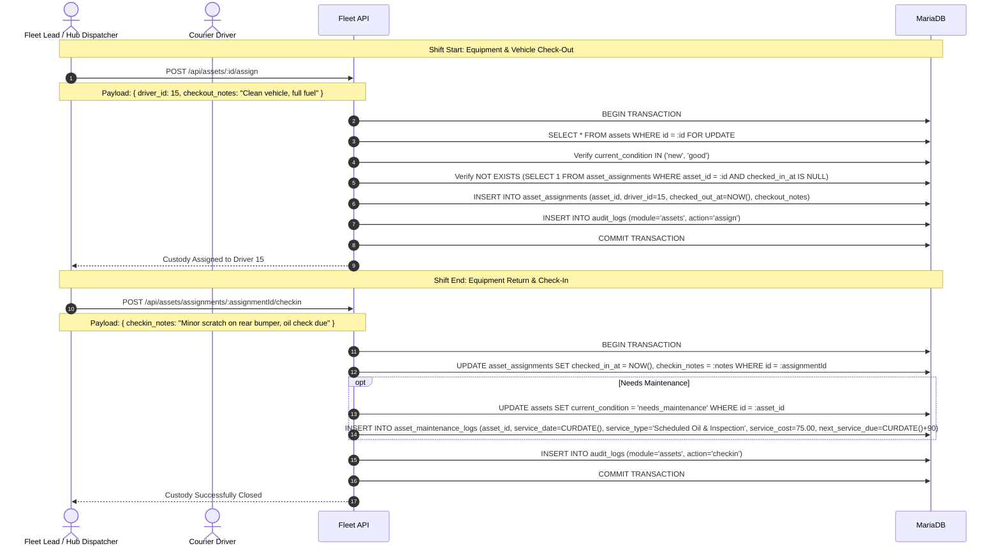

# Merchants, People, and Fleet Management

**Status:** Authoritative domain specification synthesized from `.docs/` requirements, database schema, and operational logistics practices.

Transcend manages the three primary operational foundations of a courier business:
1. **Merchants (Clients):** Commercial partners ordering parcel shipments.
2. **Personnel (HR):** Company employees branched strictly into **Internal Company Staff** (office, dispatch, finance) and **Delivery Drivers** (field couriers).
3. **Fleet & Assets:** Physical vehicles (vans, motorcycles) and hardware tools (scanners, thermal bags) paired with drivers.

---

## 1. Domain Entities & Database Schema

| Table | Scope | Key Attributes |
| --- | --- | --- |
| `clients` | Merchant accounts | `client_code`, `business_name`, `trade_license_no`, `contact_person_name`, `mobile_1`, `email`, `billing_address`, `default_pickup_address`, `pickup_latitude`, `pickup_longitude`, `current_balance`, `pending_cod_balance`, `rate_profile_tier`, `is_active` |
| `employees` | Unified personnel base profile | `employee_code`, `first_name`, `last_name`, `department`, `personnel_type` (`internal_staff`, `driver`), `employment_classification`, `compensation_type`, `base_salary`, `bank_account_iban`, `national_id`, `personal_mobile`, `employment_status`, `hire_date` |
| `company_staff` | Back-office specialization | `employee_id` (PK/FK), `job_title`, `assigned_office_hub`, `shift_schedule`, `reporting_manager_id`, `corporate_email`, `internal_phone_ext` |
| `delivery_drivers` | Courier specialization | `employee_id` (PK/FK), `driver_category`, `fleet_arrangement`, `commission_per_drop`, `license_number`, `license_class`, `license_expiry_date`, `background_check_passed`, `assigned_zone`, `max_weight_capacity_kg`, `max_volume_capacity_m3`, `dispatch_status`, `current_latitude`, `current_longitude` |
| `assets` | Vehicles & equipment inventory | `asset_tag`, `asset_name`, `category`, `acquisition_cost`, `current_book_value`, `license_plate`, `vin`, `road_tax_expiry`, `current_condition` |
| `asset_assignments` | Driver custody log | `asset_id`, `driver_id`, `checked_out_at`, `checked_in_at`, `checkout_notes`, `checkin_notes` |
| `asset_maintenance_logs` | Equipment service history | `asset_id`, `service_date`, `service_type`, `service_cost`, `vendor_service_center`, `next_service_due` |

---

## 2. Core Domain Rules & Invariants

| Rule ID | Rule Definition | Invariant & Enforcement |
| --- | --- | --- |
| **MER-01** | **Scoped Merchant Code Uniqueness** | `(organization_id, client_code)` is strictly unique. The same code may exist in different companies, but cannot duplicate within the same tenant. |
| **MER-02** | **Merchant Tenant Boundary** | All linked parcels, ledger entries, and invoices must belong to the merchant's verified company. Cross-tenant references are strictly rejected. |
| **MER-03** | **Financial View Separation** | Basic merchant contact info requires `clients.view`. Viewing `current_balance`, `pending_cod_balance`, and rates requires `clients.view_financials`. General directory listings must sanitize financial attributes for non-finance users. |
| **PER-01** | **Personnel Discriminator Integrity** | An employee must have `personnel_type` set to either `'internal_staff'` or `'driver'`. The corresponding subtype table (`company_staff` or `delivery_drivers`) must exist and share the base `employee_id`. |
| **PER-02** | **Single Account Linkage** | An employee may optionally link to a system login account via `employees.user_id`. In the schema, `user_id` is unique. |
| **DRV-01** | **Global Driver License Uniqueness** | `delivery_drivers.license_number` is globally unique. A driver is identified by `employees.id`, **not** by user account ID. |
| **DRV-02** | **Driver Dispatch Qualification Guard** | A driver cannot be assigned parcels unless: 1. `employment_status == 'active'` 2. `license_expiry_date >= CURRENT_DATE` 3. `background_check_passed == TRUE` 4. `dispatch_status IN ('available', 'on_pickup')` |
| **DRV-03** | **Duty Status vs Presence Separation** | A driver's operational `dispatch_status` (`available`, `out_for_delivery`, `off_duty`) is completely separate from their system login or contact presence (`Online`, `Offline`). An online user is not automatically on-duty. |
| **FLT-01** | **Unique Asset Tag** | `(organization_id, asset_tag)` is unique per company (e.g., `VAN-001`, `SCN-042`). |
| **FLT-02** | **Single Open Custody Rule** | An asset can have at most one active assignment where `checked_in_at IS NULL`. Checking out an asset that has not been checked in is rejected with `409 Conflict`. |
| **FLT-03** | **Decommissioned Asset Guard** | Assets with `current_condition = 'decommissioned'` or `'needs_maintenance'` cannot be checked out or dispatched. |

---

## 3. Operational User & System Flows

### Flow A: Merchant CRM Onboarding & Lifecycle

#### Merchant Lifecycle Rules:
- **Archiving / Deactivation:** A merchant can be deactivated (`is_active = FALSE`). This prevents new parcel intake, but preserves historical shipments, invoices, and ledger entries for audit.
- **Balance Invariant:** Balance mutations are strictly owned by the billing domain. Editing merchant profile details can never modify `current_balance` directly.

---

### Flow B: Personnel & Driver Onboarding

#### Driver Telematics & Duty Lifecycle:
- Driver shifts start with setting `dispatch_status = 'available'`.
- While on delivery, mobile GPS pings update `current_latitude`, `current_longitude`, and `last_location_ping`.
- At shift end, driver sets `dispatch_status = 'off_duty'`.

---

### Flow C: Fleet Custody Check-Out, Return & Maintenance

---

## 4. Permission & Security Boundary Summary

| Role | Permitted Actions | Restricted Fields / Bounds |
| --- | --- | --- |
| **Dispatcher** | View merchants, create/assign parcels, assign assets, view driver duty. | Cannot view staff payroll, driver earnings, or merchant balances. |
| **HR Manager** | Onboard/manage staff and drivers, review compliance docs, inspect payroll and IBANs. | Cannot modify merchant balances or reconcile cash. |
| **Fleet Lead** | Create/manage assets, assign hardware/vehicles, log maintenance and repair expenses. | Cannot access banking, payroll, or customer financials. |
| **Courier / Driver** | View own assigned run sheet, update parcel status, record POD, view own drop commission. | Scoped strictly to assigned parcels; no access to other drivers' records or company balance. |
| **Finance** | Full access to merchant ledgers, live balances, rate profiles, invoicing, and COD reconciliation. | Full financial control under strict audit trail. |
