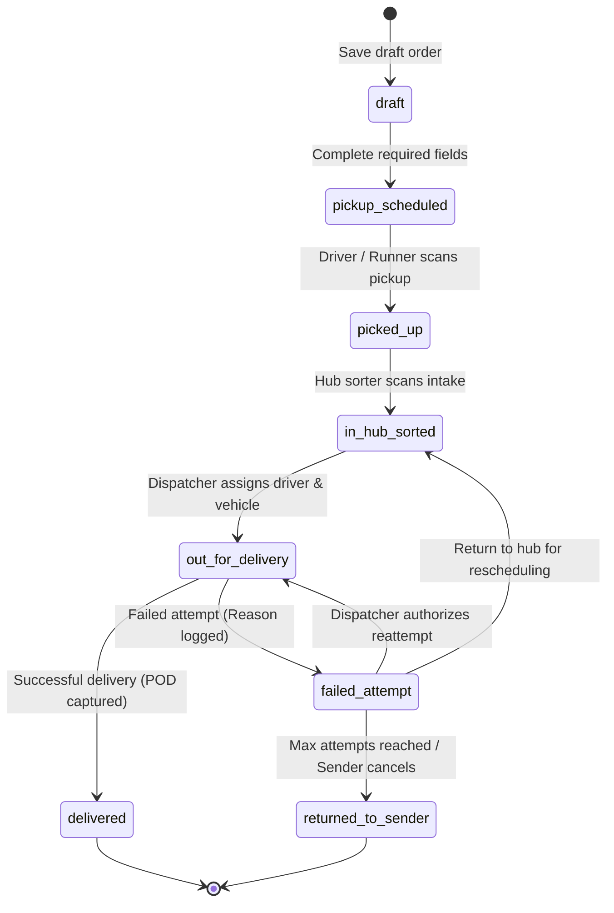
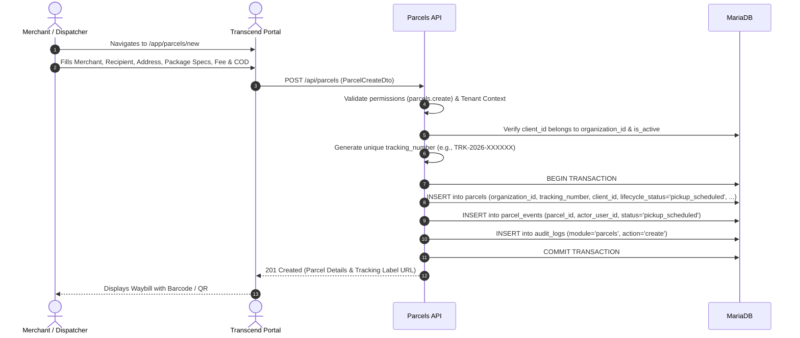
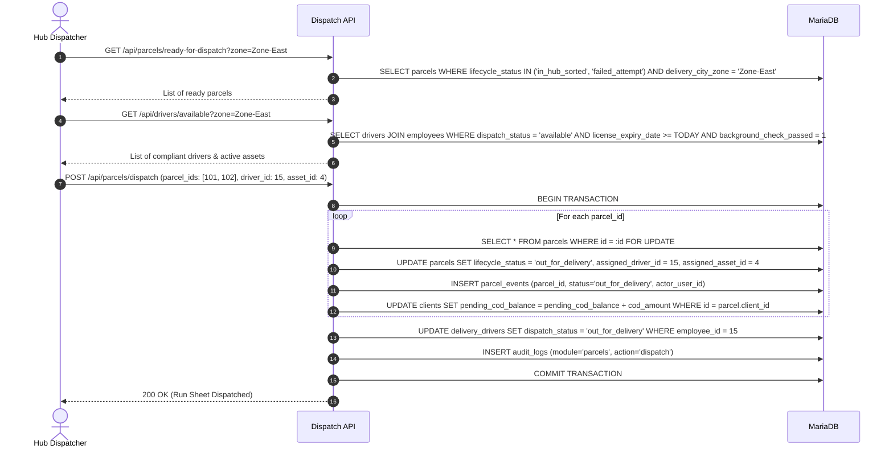
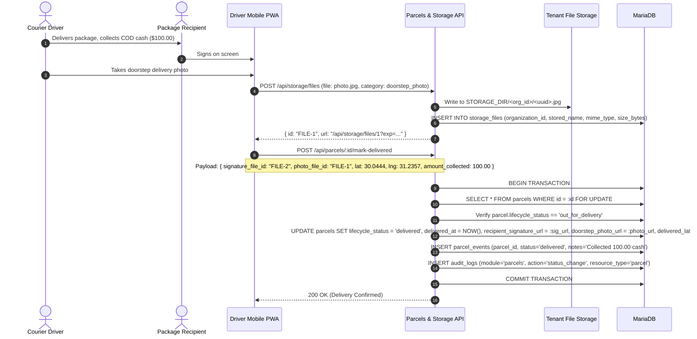
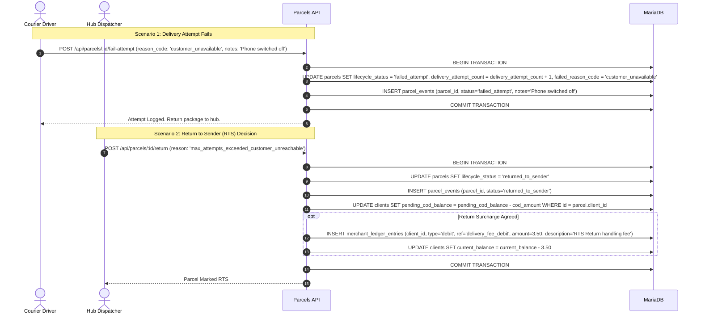

# Parcels and Delivery Operations

**Status:** Authoritative domain logic and operational specification synthesized from `.docs/` architectural requirements, database schema migrations, and courier operational workflows.

Transcend's parcel domain is the core operational engine of the courier ERP. It coordinates parcel intake, waybill generation, hub sorting, driver dispatch, mobile field delivery, proof of delivery (POD) capture, failed attempts, and returns to sender (RTS).

---

## 1. Domain Entities & Responsibilities

| Table | Scope | Key Attributes |
| --- | --- | --- |
| `parcels` | Individual shipment waybill | `tracking_number`, `client_id`, `assigned_driver_id`, `assigned_asset_id`, `lifecycle_status`, `delivery_fee`, `cod_amount`, `weight_kg`, `delivery_attempt_count`, `recipient_signature_url`, `doorstep_photo_url`, `delivered_at` |
| `parcel_events` | Append-only lifecycle audit | `parcel_id`, `actor_user_id`, `status`, `hub_location`, `notes`, `event_timestamp` |
| `storage_files` | Evidence file custody | `organization_id`, `stored_name`, `original_name`, `mime_type`, `size_bytes` |

---

## 2. Core Domain Rules & Business Invariants

| Rule ID | Rule Definition | Invariant & Enforcement |
| --- | --- | --- |
| **PAR-01** | **Global Tracking Uniqueness** | `tracking_number` is globally unique across all tenants. A parcel belongs to exactly one tenant (`organization_id`) and one merchant (`client_id`). |
| **PAR-02** | **Tenant Boundary Integrity** | The ordering merchant (`client_id`), dispatched courier (`assigned_driver_id`), assigned vehicle (`assigned_asset_id`), and proof files must belong to the parcel's verified `organization_id`. Cross-tenant assignment is strictly rejected. |
| **PAR-03** | **Required Granular Permissions** | - Creation & bulk intake: `parcels.create` - Viewing directory & tracking: `parcels.view` - Dispatch & driver assignment: `parcels.dispatch` - Operational transitions (Pick up, Sort, RTS): `parcels.update_status` - Delivery & POD submission: `parcels.mark_delivered` - Financial fee overrides: `parcels.override_fee` |
| **PAR-04** | **Driver Identification Model** | The driver reference is `delivery_drivers.employee_id` (an employee identity), **not** a login `user_id`. When drivers act in the field, the system resolves the driver's employee record from the authenticated user. |
| **PAR-05** | **Atomic Event Recording** | Every status modification to `parcels.lifecycle_status` must atomically insert a milestone record into `parcel_events` and an auditable entry into `audit_logs` in the same database transaction. |
| **PAR-06** | **Terminal States Immutability** | `delivered` and `returned_to_sender` are terminal operational states. Once reached, standard status update endpoints cannot alter the status. Any exceptional correction requires a dedicated, auditable supervisor override with financial reconciliation. |
| **PAR-07** | **Separation of Delivery & Cash Verification** | Marking a parcel as `delivered` records physical package handover and door collection facts. It **does not** mark cash as verified or credit merchant available balance. Verification occurs through cashier reconciliation in the billing domain. |

---

## 3. Parcel Lifecycle State Machine

Transcend enforces an explicit 8-state finite state machine:

### Transition Matrix & Preconditions

| From State | Allowed To State | Trigger / Command | Preconditions & System Validations |
| --- | --- | --- | --- |
| *New* | `draft` | `POST /api/parcels` | Valid merchant in same tenant; basic recipient name and city zone. |
| `draft` | `pickup_scheduled` | `PATCH /api/parcels/:id/schedule` | Complete delivery address, valid phone number, package weight > 0, non-negative delivery fee and COD amount. |
| `pickup_scheduled`| `picked_up` | `PATCH /api/parcels/:id/status` | Courier takes custody at merchant address. Inserts pickup event with actor ID. |
| `picked_up` | `in_hub_sorted` | `PATCH /api/parcels/:id/status` | Package scanned at depot. Records `hub_location`. Package sorted for zone. |
| `in_hub_sorted` | `out_for_delivery`| `POST /api/parcels/:id/dispatch` | Driver must be active, license valid, background passed, and duty status `available`. Vehicle must not be decommissioned. Increments merchant `pending_cod_balance`. |
| `out_for_delivery`| `delivered` | `POST /api/parcels/:id/mark-delivered` | Signature and/or doorstep photo uploaded to `storage_files`. GPS ping captured. Records completion timestamp `delivered_at`. |
| `out_for_delivery`| `failed_attempt` | `POST /api/parcels/:id/fail-attempt` | Valid `failed_reason_code` provided. Increments `delivery_attempt_count` by 1. |
| `failed_attempt` | `out_for_delivery`| `POST /api/parcels/:id/dispatch` | Reattempt approved by dispatcher. `delivery_attempt_count` preserved. |
| `failed_attempt` | `in_hub_sorted` | `PATCH /api/parcels/:id/status` | Driver returns un-delivered parcel to depot at end of shift. |
| `failed_attempt` | `returned_to_sender`| `POST /api/parcels/:id/return` | Authorized return. Physical handover back to merchant pickup address. Decrements merchant `pending_cod_balance`. Optional return fee debited. |

---

## 4. Operational User & System Flows

### Flow A: Parcel Intake & Waybill Creation

#### Intake Validations:
- **Recipient Contact:** `recipient_name` required, `recipient_phone` normalized (E.164 or local format), `delivery_address` and `delivery_city_zone` mandatory.
- **Physical Specifications:** `weight_kg` must be $> 0.00$ (default $0.50$ kg). Dimensions (`length_cm`, `width_cm`, `height_cm`) must be $\ge 0$ if provided.
- **Financial Terms:** `delivery_fee` $\ge 0.00$, `cod_amount` $\ge 0.00$. If `is_insured = TRUE`, `declared_value` must be $> 0.00$ and `insurance_fee` $\ge 0.00$.

---

### Flow B: Hub Sorting & Driver Dispatch Run

#### Capacity & Compliance Checks:
1. **Total Weight Capacity:** $\sum \text{weight\_kg} \le \text{delivery\_drivers.max\_weight\_capacity\_kg}$.
2. **Total Volume Capacity:** $\sum \frac{\text{length} \times \text{width} \times \text{height}}{1,000,000} \le \text{delivery\_drivers.max\_volume\_capacity\_m3}$.
3. **Vehicle Custody:** If `asset_id` is supplied, server checks `asset_assignments` to verify whether the driver has actively checked out that asset.

---

### Flow C: Doorstep Delivery Execution & Proof of Delivery (POD)

#### Proof of Delivery (POD) Evidence Rules:
- **Storage Isolation:** POD images and signature files are saved via `StorageService` under tenant-partitioned disk folders (`<STORAGE_DIR>/<organization_id>/<uuid>`).
- **Signed URL Access:** Public direct access to raw storage is blocked. Images are accessed using time-bounded 15-minute cryptographically signed URLs (`GET /api/storage/files/:id?exp=...&sig=...`).
- **GPS Telematics Ping:** The mobile client captures GPS coordinates (`delivered_latitude`, `delivered_longitude`) at the precise moment of completion to verify doorstep presence.

---

### Flow D: Delivery Failure, Reattempt & Return to Sender (RTS)

#### Standard Failure Reason Codes:
1. `customer_unavailable`: Customer not present at delivery address.
2. `phone_unreachable`: Recipient phone busy, powered off, or disconnected.
3. `incorrect_address`: Street, building, or landmark details invalid.
4. `refused_delivery`: Recipient rejected the package.
5. `refused_cod_payment`: Recipient refused to pay requested COD amount.
6. `customer_rescheduled`: Recipient requested delivery on an alternate date.
7. `damaged_package`: Package arrived damaged; returned for inspection.

---

## 5. Security & Isolation Controls

1. **Composite Tenant Checks:** In every SQL query, repositories must append `AND parcels.organization_id = :org_id`.
2. **Pessimistic Locking on Updates:** Changing parcel status, assigning drivers, or submitting delivery POD must acquire an exclusive row lock (`SELECT ... FOR UPDATE`) to prevent simultaneous dispatcher collisions or duplicate status transitions.
3. **Audit Immutability:** All updates, fee adjustments, and status changes write entity snapshots (`old_values`, `new_values`) into `audit_logs` inside the modifying transaction.
