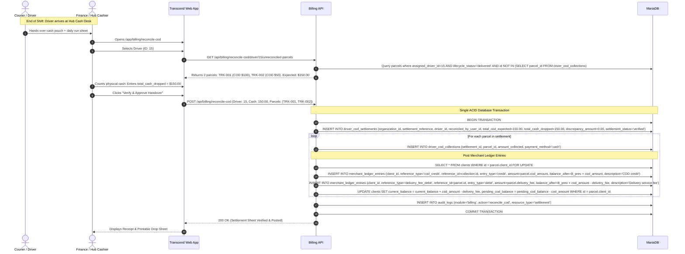
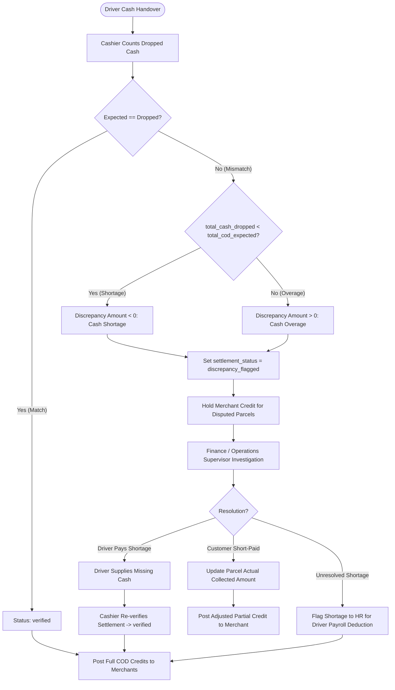
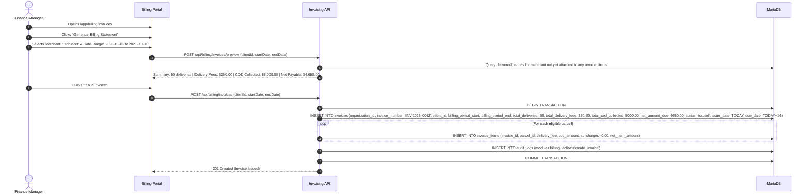
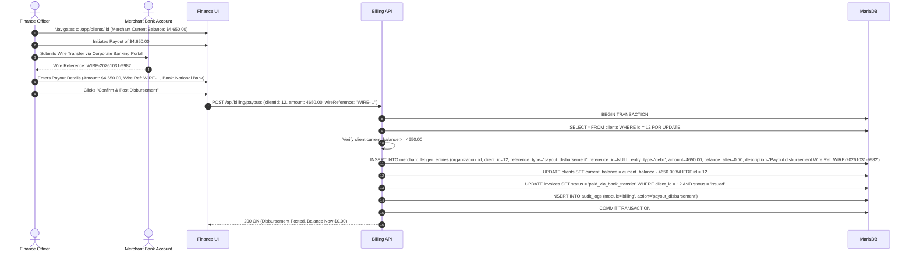

# Cash-on-Delivery (COD), Merchant Ledger & Invoicing

**Status:** Authoritative domain financial specification synthesized from `.docs/` requirements, MariaDB schema, ACID transaction rules, and double-entry ledger principles.

Transcend manages the complete financial bridge between doorstep cash collection, hub cashier verification, running merchant balance ledgers, periodic invoicing, and bank payout disbursements.

---

## 1. Domain Entities & Responsibilities

| Table | Scope | Key Attributes |
| --- | --- | --- |
| `driver_cod_settlements` | Driver daily shift cash drop sheet | `settlement_reference`, `driver_id`, `reconciled_by_user_id`, `total_cod_expected`, `total_cash_dropped`, `discrepancy_amount`, `settlement_status`, `settled_at` |
| `driver_cod_collections` | Itemized doorstep collection per parcel | `settlement_id`, `parcel_id`, `amount_collected`, `payment_method` (`cash`, `pos_card`, `qr_transfer`), `collected_at` |
| `clients` | Merchant financial balances | `current_balance` (available funds), `pending_cod_balance` (in-transit funds), `rate_profile_tier` |
| `merchant_ledger_entries` | Running balance journal entries | `client_id`, `reference_type`, `reference_id`, `entry_type` (`credit`, `debit`), `amount`, `balance_after`, `description` |
| `invoices` | Periodic statement of account | `invoice_number`, `client_id`, `billing_period_start`, `billing_period_end`, `total_deliveries`, `total_delivery_fees`, `total_cod_collected`, `net_amount_due`, `status` |
| `invoice_items` | Individual parcel billing lines | `invoice_id`, `parcel_id`, `delivery_fee`, `cod_amount`, `surcharges`, `net_item_amount` |

---

## 2. Fundamental Accounting & Money Invariants

| Rule ID | Rule Definition | Invariant & Mathematical Model |
| --- | --- | --- |
| **FIN-01** | **Decimal Precision Standard** | All monetary columns use `DECIMAL(12,2)`. BigInteger IDs and financial values cross the API/DB boundary as strings. Arithmetic must use exact decimal math (e.g. `bignumber.js` or integer cents) to prevent floating-point drift. |
| **FIN-02** | **Tenant Isolation of Funds** | Every settlement, parcel, collection, invoice, ledger entry, and client balance must belong to the caller's verified `organization_id`. Inter-company money transfers or balance cross-credits are impossible. |
| **FIN-03** | **Atomic Ledger Invariant** | Mutating `clients.current_balance` independently without an accompanying `merchant_ledger_entries` record is strictly forbidden. The balance update and the ledger entry must commit in the exact same database transaction. |
| **FIN-04** | **Balance Perspective & Sign Convention** | The ledger is maintained from the **Merchant's Perspective**: - **Credit (+):** Increases merchant balance (e.g., COD collected from recipients, manual cash deposits). Courier owes merchant. - **Debit (-):** Decreases merchant balance (e.g., delivery service fees, return charges, payout disbursements to merchant bank account). - $\text{Positive Balance } (> 0)$: Courier owes money to merchant. - $\text{Negative Balance } (< 0)$: Merchant owes money to courier. |
| **FIN-05** | **Separation of Physical Delivery & Verified Cash** | Marking a parcel `delivered` records physical drop-off and collected evidence. It **does NOT** immediately credit the merchant's available `current_balance`. Cash must be verified and reconciled by hub finance during the daily handover. |
| **FIN-06** | **Single Collection Uniqueness** | A parcel can have at most one `driver_cod_collections` record. MariaDB enforces a `UNIQUE KEY (parcel_id)` on `driver_cod_collections`. This prevents duplicate cash collection claims across multiple settlement sheets. |
| **FIN-07** | **Discrepancy Formula** | $\text{discrepancy\_amount} = \text{total\_cash\_dropped} - \text{total\_cod\_expected}$. - Negative value represents a **Cash Shortage** (driver turned in less than expected). - Positive value represents a **Cash Overage** (driver turned in more than expected). - Zero represents a perfect reconciliation. |

---

## 3. Financial User & System Flows

### Flow A: Driver Daily COD Handover & Cashier Reconciliation

#### Verification Rules:
1. **Pessimistic Lock:** The client row must be locked using `SELECT ... FOR UPDATE` before posting ledger entries to prevent race conditions from concurrent delivery reconciliations or fee charges.
2. **Sequential Balances:** For each ledger entry, `balance_after` must equal the exact previous balance plus (if credit) or minus (if debit) the entry amount:
   $$\text{balance\_after} = \text{balance}_{\text{previous}} \pm \text{amount}$$
3. **Pending COD Release:** Reconciling a parcel moves funds from `pending_cod_balance` to `current_balance`.

---

### Flow B: Discrepancy Flagging & Shortage Resolution

#### Discrepancy Rules:
- If a settlement is marked `discrepancy_flagged`, finance policy determines whether undisputed parcels within the batch are posted or held until sign-off.
- The discrepancy reason and supervisor sign-off are recorded in `driver_cod_settlements.reconciliation_notes` and audited in `audit_logs`.

---

### Flow C: Merchant Invoicing & Periodic Settlement

#### Invoice Lifecycle States:
1. `draft`: Prepared statement; can be reviewed, edited, or recalculated.
2. `issued`: Finalized legal billing document sent to merchant. Parcel lines locked.
3. `paid_via_balance_offset`: Cleared automatically against the merchant's positive running balance.
4. `paid_via_bank_transfer`: Settled via external wire transfer.
5. `overdue`: Payment deadline (`due_date`) passed without settlement.

---

### Flow D: Merchant Payout Disbursement

When a merchant has an accumulated positive balance (courier owes merchant money collected from recipients), Finance disburses a bank wire payout.

---

## 4. Comprehensive Worked Accounting Example

The following table demonstrates the exact running balance ledger transformations for a merchant (`TechMart`) across a full business lifecycle:

| Step | Business Event | Reference Type | Direction | Amount | Balance After | Pending COD | Notes |
| --- | --- | --- | --- | --- | --- | --- | --- |
| 1 | Onboarding | — | — | — | **$0.00** | **$0.00** | Initial balance |
| 2 | Parcel 1 Dispatched | — | — | — | $0.00 | **$100.00** | $100 COD in transit |
| 3 | Parcel 2 Dispatched | — | — | — | $0.00 | **$150.00** | Additional $50 in transit |
| 4 | Parcel 1 Reconciled | `cod_credit` | **Credit** | $100.00 | **$100.00** | $50.00 | Driver drops cash |
| 5 | Parcel 1 Delivery Fee | `delivery_fee_debit` | **Debit** | $7.00 | **$93.00** | $50.00 | Courier service fee |
| 6 | Parcel 2 Reconciled | `cod_credit` | **Credit** | $50.00 | **$143.00** | $0.00 | Driver drops cash |
| 7 | Parcel 2 Delivery Fee | `delivery_fee_debit` | **Debit** | $7.00 | **$136.00** | $0.00 | Courier service fee |
| 8 | Return Surcharge | `delivery_fee_debit` | **Debit** | $3.50 | **$132.50** | $0.00 | RTS return fee |
| 9 | Payout Disbursement | `payout_disbursement` | **Debit** | $132.50 | **$0.00** | $0.00 | Wire to merchant |

---

## 5. Idempotency & Error Handling Controls

1. **Idempotent Reconciliation:** Repeating a COD reconciliation request with the same `settlement_reference` returns the existing verified settlement sheet without creating duplicate ledger entries or increasing merchant balance twice.
2. **Preventing Double Charging on Invoicing:** When an invoice is issued, it itemizes parcels whose delivery fees and COD amounts have already been posted to the ledger during daily operations. The invoice creation does **not** post duplicate debit/credit entries to `merchant_ledger_entries`.
3. **Negative Balance Protection:** If a merchant's balance goes negative (e.g. high volume of delivery fees or returns with zero COD collections), `clients.current_balance` drops below zero (e.g. `-$45.00`). In this case, Transcend generates an invoice where `net_amount_due` is payable **by** the merchant to the courier.
