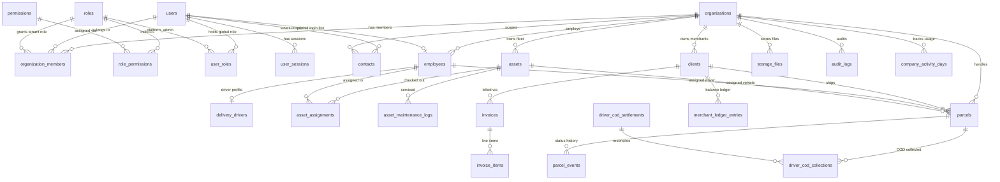

*This project has been created as part of the 42 curriculum by ataan, wmin-kha, zabu-bak, zmin.*

# Transcend

---

## Description

**Transcend** is a multi-tenant courier and last-mile logistics Enterprise Resource Planning (ERP) web application. Its goal is to connect every operational handoff of a parcel delivery company—from merchant intake and hub sorting to driver dispatch, proof of delivery, and Cash-on-Delivery (COD) financial settlement—inside a single, role-governed, real-time workspace.

### Key Features

- **Multi-Tenant Platform & Organization Workspaces:** Platform administrators create, edit, suspend/reactivate courier companies (tenants), assign/revoke tenant administrators, and monitor tenant activity. Users can belong to multiple organizations with independent roles and switch workspaces cleanly without data leakage.
- **Role-Based Access Control (RBAC) & User Management:** Eight built-in roles (`platform_admin`, `org_admin`, `dispatcher`, `hub_sorter`, `finance`, `hr_manager`, `fleet_lead`, `driver`) with granular permissions, field-level financial/payroll redaction, driver `assigned_only` parcel scoping, Argon2id password hashing, rotating HttpOnly refresh sessions with reuse detection, and **42 OAuth 2.0** login.
- **End-to-End Parcel Lifecycle & Proof of Delivery:** Waybill creation with barcode/QR codes, pickup, hub sorting, dispatch run assignment (`RUN-<yyyymmdd>-<id>`), failed-attempt handling, return-to-sender flows, delivery proof uploads (signature pad, photos, PDF notes with magic-byte verification and signed URLs), and a rate-limited **public parcel tracking page** (`/track`).
- **Merchants, Drivers & Fleet Custody:** Full CRUD with search, filters, sorting, and pagination for merchant accounts, driver onboarding/compliance/duty status, and vehicle/equipment check-out, check-in, and maintenance logs.
- **ACID COD Billing, Ledger & Settlement:** Exact decimal financial accounting covering pending COD tracking, driver cash handover reconciliation, immutable merchant ledgers, draft/issued delivery-fee invoices, and merchant payouts.
- **Real-Time Live Updates, Contacts & Presence:** Authenticated Socket.IO connections refresh open company screens on every audited create/update/delete action and stream live `online` / `offline` / `suspended` presence for saved company contacts.
- **Audit Trail & User Activity Insights:** Append-only audit logs with before/after diffs and tiered retention (90/180/365 days), paired with a company activity insights dashboard (7/30/90-day active members, visits, module changes, and security events).
- **Multilingual (EN / AR / TH) & Full RTL Support:** Complete English, Arabic, and Thai translations across all 13 namespaces with instant LTR↔RTL layout mirroring.
- **Public Website & Legal Compliance:** Marketing pages (`/`, `/product`, `/solutions`, `/contact`), public tracking (`/track`), and accessible Privacy Policy (`/privacy`) and Terms of Service (`/terms`) pages.

---

## Instructions

### Prerequisites

- **Node.js 24 LTS** (or Node `>=22.13.0`, see [`.nvmrc`](.nvmrc)) and **npm**
- **Docker** and **Docker Compose v2.24.4+**

### 1. Environment Configuration

Copy the root environment template and replace the placeholder secrets:

```sh
cp .env.example .env
```

Edit `.env` and set strong values for `DB_ROOT_PASSWORD`, `DB_PASS`, and `JWT_SECRET`. You can generate a secure `JWT_SECRET` with:

```sh
node -e "console.log(require('crypto').randomBytes(48).toString('hex'))"
```

*(Optional — 42 OAuth 2.0)* To enable **Log in with 42**, register these redirect URIs in your 42 Intra application and set `FORTYTWO_APP_ID` and `FORTYTWO_APP_SECRET` in `.env`:

- `https://localhost/api/auth/42/callback` (Docker HTTPS stack)
- `http://localhost:5173/api/auth/42/callback` (hot-reload development)

### 2. Run with Docker (Single Command — HTTPS Production Stack)

```sh
docker compose up --build -d
```

Verify container health:

```sh
docker compose ps
```

- **Application (HTTPS):** `https://localhost` (`http://localhost:8080` automatically redirects `301` to HTTPS; change `FRONTEND_PORT` / `FRONTEND_HTTPS_PORT` in `.env` if ports are occupied on your host).
- **API Liveness / Readiness:** `https://localhost/api/health` and `https://localhost/api/health/ready` (use `curl -k` with the auto-generated local self-signed certificate).
- NGINX terminates TLS 1.2/1.3 and proxies `/api/` and `/socket.io/` to the internal NestJS backend; only NGINX ports are published to `127.0.0.1`. MariaDB and the backend run on the isolated `transcend_net` bridge network.
- A one-shot `migrate` service applies all 20 TypeORM migrations automatically before the backend starts.
- Stop containers without deleting database or upload volumes:

```sh
docker compose down
```

### 3. Create Accounts & Load Demo Data

To create the first platform administrator interactively:

```sh
docker compose exec -it backend npm run create-platform-admin
```

For evaluation and testing, load the demo companies, accounts, merchants, drivers, and fleet (`--force` is required in the production container because demo accounts share the password `Transcend-demo-1`):

```sh
docker compose exec backend npm run seed:demo -- --force
```

#### Seeded Demo Accounts (Password: `Transcend-demo-1`)

| Username | Access & Role(s) |
| --- | --- |
| `lina` | Tenant Admin (`org_admin`), Meridian Courier |
| `dana.saleh` | Dispatcher, Meridian Courier |
| `omar.hub`, `rania.finance`, `yusuf.hr`, `maya.fleet`, `samir.farah` | Hub Sorter, Finance, HR Manager, Fleet Lead, Driver — Meridian Courier |
| `leen.mansour` | Unlinked Driver account at Meridian Courier (for testing account linking) |
| `karim.harbor` | Tenant Admin (`org_admin`), Harbor Express |
| `noor` | Dispatcher (Meridian Courier) + Finance (Harbor Express) |
| `alaa`, `zaid` | Dispatcher (Meridian Courier) + Finance (Harbor Express) — 42 OAuth enabled |
| `zmin` | Platform Admin + Dispatcher (Meridian Courier) — 42 OAuth enabled |
| `wai` | Tenant Admin (Harbor Express) — 42 OAuth enabled |
| `zara.platform` | Platform Admin + Dispatcher (Meridian Courier) |
| `platform.ops` | Platform Admin only |
| `ex.member` | Inactive membership only (no workspace) |
| `new.hire` | Dispatcher (Meridian Courier) — forced password change on first login |

### 4. Development & Verification Commands

**Docker with hot reload** (`http://localhost:5173`, local dev only):

```sh
npm run docker:dev
```

**Host development:**

```sh
npm run setup
npm run docker:db
npm run migration:run --prefix backend
npm run dev:backend
# In a second terminal:
npm run dev:frontend
```

**Quality gates & tests:**

```sh
npm run verify                             # Lint + build backend & frontend + backend unit/security tests
npm run test:db --prefix backend           # Full MariaDB migration & SQL integration test suite
npm run format:check --prefix frontend     # Prettier formatting check
node frontend/scripts/check-translations.js --strict  # Verify EN/AR/TH translation parity
```

---

## Team Information

All four team members contributed as full-stack developers alongside their primary leadership roles:

| 42 Login | Assigned Role(s) | Responsibilities |
| --- | --- | --- |
| **`wmin-kha`** | **Product Owner (PO)** & Developer | Defined product vision, business workflows, acceptance criteria, and feature priorities; led core identity, RBAC, contacts/presence, activity insights, i18n infrastructure, and financial COD billing/ledger implementation. |
| **`ataan`** | **Project Manager (PM) / Scrum Master** & Developer | Coordinated sprints, milestones, task tracking, and team alignment; owned 42 OAuth 2.0, NGINX HTTPS/TLS and WebSocket proxy infrastructure, real-time notifications, audit trail, legal pages, and Arabic/Thai translations & RTL fixes. |
| **`zabu-bak`** | **Technical Lead / Architect** & Developer | Established the monorepo architecture, system/domain specifications, Docker containerization, code quality gates, and security boundaries; reviewed critical changes and resolved cross-cutting realtime, tracking, and billing edge cases. |
| **`zmin`** | **Developer** | Built the custom reusable design system components, platform tenant & administrator administration UI, secure file storage & proof-of-delivery system, and end-to-end CRUD modules for clients, drivers, assets, parcels, and public tracking. |

---

## Project Management

- **Work Organization & Task Breakdown:** Work was broken down by vertical domain module (Identity/RBAC, Platform Tenants, Clients, Drivers, Assets, Parcels, Billing/COD, Storage, Real-Time/Audit, i18n/RTL) with agreed DTO contracts, permission codes, and shared module exports (`index.ts`) so team members could work in parallel on short-lived branches (`<type>/<scope>/<description>`) with minimal merge conflicts.
- **Project Management Tool:** **Notion** was used to maintain the product backlog, sprint plans, domain specifications, and task ownership, alongside **GitHub Pull Requests** for peer code reviews and linear squash/merge integration.
- **Communication Channels & Meetings:** Day-to-day async coordination and quick technical discussions took place on **Discord**, while regular sprint planning, architecture reviews, and milestone syncs were held over **Google Meet**.
- **Quality & Review Practices:** Conventional Commits, a Husky `pre-push` hook running `npm run verify` (ESLint, TypeScript/Vite/Nest builds, and security/unit tests), database integration tests (`test:db`), and automated translation parity checks (`check-translations.js`).

---

## Technical Stack

### Frontend

- **React 19** + **TypeScript 5.9** + **Vite 7** — Modern component-based SPA with strict typing and fast builds.
- **Tailwind CSS 4** + **daisyUI 5** — Utility-first styling with a custom `transcend` theme (`frontend/src/styles.css`) and native CSS logical property support for RTL mirroring.
- **React Router 7** — Nested route guards (`RequireSession`, `RequirePasswordChosen`, `RequirePermission`, `RequirePlatform`) and tenant-scoped URLs (`/app/:companySlug/...`).
- **TanStack Query 5** & **Jotai** — Tenant-keyed server-state caching (cleared automatically on workspace switch/logout) and lightweight client state.
- **React Hook Form 7** + **Zod 4** — Declarative client-side form validation aligned with backend DTOs.
- **i18next / react-i18next** — Multi-namespace localization (`en`, `ar`, `th`) with automatic language detection and dynamic `dir="rtl"` switching.
- **Socket.IO Client**, **JsBarcode**, **qrcode.react** — Real-time updates/presence and printable parcel waybill codes.

### Backend

- **NestJS 11** (Express platform) + **TypeScript 5.9** — Modular monolith architecture with strict controller → service → repository separation and dependency injection.
- **TypeORM 0.3.25** (`@nestjs/typeorm`, `mysql2`) — Entity modeling (25 entities) and 20 versioned migrations (`synchronize: false`).
- **Socket.IO** (`@nestjs/websockets`, `@nestjs/platform-socket.io`) — Authenticated WebSocket gateway for tenant notifications and live presence.
- **Security & Validation:** `argon2` (Argon2id password hashing), `@nestjs/jwt`, `helmet`, `@nestjs/throttler`, `cookie-parser`, `class-validator` / `class-transformer`, Multer + custom magic-byte signature validation.

### Database

- **MariaDB 10.11 (InnoDB, `utf8mb4_unicode_ci`)**
- **Why MariaDB was chosen:** Logistics ERP operations and COD accounting require strict ACID transactions, row-level locking (`READ COMMITTED` for concurrent parcel dispatch and cash handovers), exact fixed-point `DECIMAL(12,2)` arithmetic for money, and composite foreign keys to enforce relational and tenant integrity at the storage layer.

### Infrastructure

- **Docker & Docker Compose** — Multi-stage Dockerfiles, one-shot migration container, health checks, and persistent named volumes (`mariadb_data`, `uploads_data`).
- **NGINX** — TLS 1.2/1.3 termination, HTTP→HTTPS `301` redirect, HSTS/security headers, SPA fallback, and WebSocket proxy (`/socket.io/`).

### Key Technical Justifications

- **Modular Monolith over Microservices:** Keeps transactional boundaries (e.g., recording delivery + posting pending COD + writing audit rows in one DB transaction) simple, reliable, and strongly consistent for a 4-person team.
- **Access Tokens in Memory + Rotating HttpOnly Refresh Cookies:** Protects against XSS token theft and detects stolen refresh token reuse within a 10-second rotation grace window.
- **Decimal Strings for Currency:** Monetary values stay strings across SQL, API JSON, and UI helpers to eliminate IEEE-754 floating-point rounding bugs.

---

## Database Schema

The database contains **25 TypeORM entities** managed by **20 versioned migrations** (`backend/src/database/migrations/`). Full column-level reference lives in [`.docs/Data-Dictionary-and-Entity-Relationship-Reference.md`](.docs/Data-Dictionary-and-Entity-Relationship-Reference.md).



### Tables, Key Fields & Data Types

| Domain | Tables | Key Fields & Data Types |
| --- | --- | --- |
| **Identity & Sessions** | `users`, `user_sessions` | `id` (`BIGINT UNSIGNED PK`), `username` (`VARCHAR(64) UNIQUE`), `email` (`VARCHAR(191) UNIQUE`), `password_hash` (`VARCHAR(255)` Argon2id), `display_name` (`VARCHAR(64)`), `avatar_file_id` (`BIGINT UNSIGNED FK`), `must_change_password` (`BOOLEAN`), `family_id` (`CHAR(22)`), `token_hash` / `previous_token_hash` (`CHAR(64)` SHA-256). |
| **RBAC & Multi-Tenancy** | `organizations`, `organization_members`, `roles`, `permissions`, `role_permissions`, `user_roles` | `slug` (`VARCHAR(64) UNIQUE`), `is_active` (`BOOLEAN`), `code` (`VARCHAR(64) UNIQUE`), `scope` (`ENUM('all','assigned_only')`), composite unique `(organization_id, user_id)`. |
| **Contacts & Activity** | `contacts`, `company_activity_days` | `organization_id` + `owner_user_id` + `contact_user_id` (`BIGINT UNSIGNED`), `activity_date` (`DATE`), `visit_count` (`INT UNSIGNED`). |
| **Merchants & Parcels** | `clients`, `parcels`, `parcel_events` | `client_code` (`VARCHAR(32)`), `current_balance` & `pending_cod_balance` (`DECIMAL(12,2)`), `tracking_number` (`VARCHAR(32) UNIQUE`), `lifecycle_status` (`ENUM`), `delivery_fee`, `cod_amount`, `collected_amount` (`DECIMAL(12,2)`), `weight_kg` (`DECIMAL(8,2)`), `delivered_latitude`/`longitude` (`DECIMAL`), proof file FK IDs. |
| **Drivers & Fleet** | `employees`, `delivery_drivers`, `assets`, `asset_assignments`, `asset_maintenance_logs` | `employee_code` (`VARCHAR(32)`), `personnel_type` (`ENUM`), `base_salary` (`DECIMAL(12,2)`), `license_number`, `duty_status` (`ENUM`), `asset_tag` (`VARCHAR(32)`), `condition_status` (`ENUM`), `checked_out_at` / `checked_in_at` (`TIMESTAMP`). |
| **Billing & COD Ledger** | `driver_cod_collections`, `driver_cod_settlements`, `merchant_ledger_entries`, `invoices`, `invoice_items` | `expected_amount`, `collected_amount`, `handed_over_amount`, `discrepancy_amount`, `amount`, `balance_after`, `total_amount` (all `DECIMAL(12,2)`), `entry_type` / `status` (`ENUM`). |
| **Storage & Audit** | `storage_files`, `audit_logs` | `stored_name` (`CHAR(36)` UUID), `original_name` (`VARCHAR(255)`), `mime_type` (`VARCHAR(128)`), `size_bytes` (`INT UNSIGNED`), `action`, `resource_type`, `outcome`, `before_values`/`after_values` (`JSON`), `retain_until` (`TIMESTAMP`). |

---

## Features List

| Feature | Description | Team Member(s) |
| --- | --- | --- |
| **Public Website & Legal Pages** | Landing, Product, Solutions, browser-local Contact brief, Privacy Policy (`/privacy`), Terms of Service (`/terms`), and 404 pages. | `zabu-bak`, `ataan`, `zmin` |
| **Authentication & Session Security** | Email/username login, Argon2id hashing, rotating HttpOnly refresh cookies, reuse detection, multi-tab sync, forced first-login password change, and **Log in with 42** OAuth 2.0. | `wmin-kha`, `ataan` |
| **User Profile & Avatar** | Self-service `/profile` page displaying workspaces and account info, display name & password updates, avatar upload/removal with initials fallback, and lightbox viewer. | `wmin-kha` |
| **Platform Administration Portal** | Isolated `/platform` dashboard for platform admins to create, edit, suspend/reactivate courier organizations, assign/revoke tenant admins, and review platform activity. | `zmin`, `wmin-kha`, `zabu-bak` |
| **People & Access (RBAC)** | Tenant user directory, account creation with generated one-time passwords, role assignment across 8 roles, password resets, deactivation/reactivation, and read-only role permissions overview. | `wmin-kha` |
| **Company Contacts & Live Presence** | Role-matrix contact eligibility, add/remove company contacts grouped by role, and real-time `Online` / `Offline` / `Suspended` status via Socket.IO with 30s disconnect grace period. | `wmin-kha`, `zabu-bak` |
| **Merchant Accounts (Clients)** | Tenant-scoped CRM with search/filter/sort/pagination, rate tiers, financial balance protection (`clients.view_financials`), archive/reactivate, and embedded ledger/invoices views. | `zmin`, `wmin-kha` |
| **Parcels, Dispatch & Public Tracking** | Waybill generation (`TRC-...`) with QR/barcodes, step-by-step lifecycle transitions, driver/vehicle dispatch runs, assigned-only driver access, proof of delivery (signature pad, photo, PDF), and rate-limited public `/track` page. | `zmin`, `wmin-kha`, `zabu-bak` |
| **Drivers & Fleet Assets** | Driver onboarding, compliance/license expiry tracking, duty status, login account linking, field-level payroll redaction; vehicle/equipment inventory, check-out/check-in custody, and maintenance logs. | `zmin` |
| **COD Cash Handover, Ledger, Invoices & Payouts** | Pending COD tracking at delivery, cashier handover reconciliation with discrepancy detection, immutable merchant ledger history, draft/issued delivery-fee invoices, and merchant payouts. | `wmin-kha`, `zabu-bak` |
| **Secure File Storage** | Per-tenant and per-account UUID disk storage, MIME + magic-byte validation, expiring HMAC-SHA256 signed URLs, XHR upload progress bars, inline image/PDF preview, and file deletion. | `zmin`, `wmin-kha` |
| **Real-Time Live Updates & Audit Trail** | Socket.IO broadcasts of `CREATE`/`UPDATE`/`DELETE` events scoped by company and role permissions; append-only audit log viewer with change diffs and tiered retention. | `ataan`, `zmin`, `zabu-bak` |
| **User Activity Insights Dashboard** | Privacy-preserving 7/30/90-day company analytics showing active members, visits, business changes, security events, accessible daily bar chart, and role/module breakdowns. | `wmin-kha` |
| **Internationalization (i18n) & RTL** | Complete English, Arabic, and Thai translations across 13 namespaces, language switcher, automated parity script, and full Arabic RTL layout mirroring. | `wmin-kha`, `ataan` |

---

## Modules

### Point Calculation Summary

- **Major Modules (5 × 2 pts):** **10 points**
- **Minor Modules (9 × 1 pt):** **9 points**
- **Total:** **19 points** (**14 mandatory points** + **5 bonus points**, reaching the maximum 5-point bonus cap)

### Module Breakdown & Justifications

| # | Category | Module | Type | Pts | Justification & Implementation Summary | Contributor(s) |
| --- | --- | --- | --- | :---: | --- | --- |
| 1 | **IV.1 Web** | Use a framework for both the frontend and backend | Major | **2** | Chosen to structure a large multi-domain ERP with strict type safety and clear module boundaries. Implemented with **React 19** (+ Vite, React Router 7, TanStack Query) on the frontend and **NestJS 11** on the backend. | `zabu-bak`, `wmin-kha`, `zmin`, `ataan` |
| 2 | **IV.1 Web** | Implement real-time features using WebSockets or similar technology | Major | **2** | Essential for multi-user dispatch desks and finance teams working concurrently on the same parcels and cash handovers. Implemented via Socket.IO `EventsGateway` (`backend/src/modules/notifications/`) with JWT handshake auth, per-organization/per-user rooms, permission-filtered broadcasts, exponential reconnect backoff, and live presence (`frontend/src/hooks/useWebSocket.ts`, `useLiveUpdates.ts`). | `ataan`, `wmin-kha`, `zabu-bak` |
| 3 | **IV.1 Web** | Use an ORM for the database | Minor | **1** | Ensures maintainable entity definitions and safe parameterized queries across 25 tables. Implemented with **TypeORM 0.3.25** (`@nestjs/typeorm`), 25 `@Entity` classes, and 20 versioned migrations (`backend/src/database/migrations/`). | `zabu-bak`, `wmin-kha`, `zmin` |
| 4 | **IV.1 Web** | A complete notification system for all creation, update, and deletion actions | Minor | **1** | Keeps operators informed of every data mutation across modules. Backend `AuditNotifications` subscribes to every audited `create`, `update`, `status_change`, `assign`, `revoke`, `transfer`, `password_reset`, and `delete` event and emits `CREATE`/`UPDATE`/`DELETE` WebSocket notifications to authorized company members; frontend pairs `Toaster`/`useToast` feedback across all modules with `useLiveUpdates` live synchronization. | `ataan`, `zmin`, `wmin-kha` |
| 5 | **IV.1 Web** | Custom-made design system with reusable components, color palette, typography, and icons (min. 10 reusable components) | Minor | **1** | Provides consistent, high-contrast operational UX across marketing, tenant, and platform areas. Defined in [`DESIGN.md`](DESIGN.md) and `frontend/src/styles.css` (custom `transcend` theme palette, typography classes, custom inline SVG icon system) with **19+ reusable components** in `frontend/src/global-components/` (`AnalyticsCard`, `Avatar`, `Breadcrumbs`, `Button`, `DashboardLayout`, `DetailItem`, `Dialog`, `ExpiryDate`, `ImageViewer`, `Input`, `PasswordInput`, `Select`, `Textarea`, `LanguageSwitcher`, `ModulePage`, `SelectFilter`, `SidebarContent`, `Table`/`TableToolbar`/`TablePagination`, `TipCard`, `Toaster`). | `zmin`, `zabu-bak`, `wmin-kha` |
| 6 | **IV.1 Web** | Implement advanced search functionality with filters, sorting, and pagination | Minor | **1** | Operations teams routinely scan hundreds of parcels, merchants, drivers, assets, and audit logs. Implemented end-to-end with debounced search, status/queue filters, multi-column sorting, and server-side pagination across Parcels, Clients, Drivers, Assets, Audit Logs, Billing, and Platform Tenants. | `zmin`, `wmin-kha`, `ataan` |
| 7 | **IV.1 Web** | File upload and management system | Minor | **1** | Needed for courier Proof of Delivery (photos, drawn signatures, scanned PDF notes) and user avatars. Implemented in `backend/src/modules/storage/` and `frontend/src/modules/parcels/components/ProofField.tsx` + `ProofPreview.tsx` + `AvatarForm.tsx`: supports multiple file types (JPEG, PNG, WebP, PDF, plus `.doc`/`.docx` rules), client & server MIME/size/magic-byte validation (`file-signature.ts`), tenant-isolated UUID storage with expiring HMAC signed URLs, inline image/PDF preview, XHR progress bar (`api-client.ts`), and file deletion. | `zmin`, `wmin-kha` |
| 8 | **IV.2 A11y & i18n** | Support for multiple languages (at least 3 languages) | Minor | **1** | Supports multilingual courier teams across regions. Implemented with `i18next` + `react-i18next` (`frontend/src/app/i18n.ts`), `LanguageSwitcher.tsx`, **3 complete translations** (**English**, **Arabic**, **Thai**) across 13 namespaces, localized date/number formatting, and an automated CI/lint parity validator (`frontend/scripts/check-translations.js`). | `wmin-kha`, `ataan` |
| 9 | **IV.2 A11y & i18n** | Right-to-left (RTL) language support | Minor | **1** | Provides native usability for Arabic-speaking teams rather than flipped text alone. Switching to Arabic sets `document.documentElement.dir = 'rtl'` dynamically, mirrors layouts via 117 CSS logical utilities (`ms-`, `me-`, `ps-`, `pe-`, `inset-s-`, `rtl:-scale-x-100`), isolates LTR tokens (`dir="ltr"` on emails, phone numbers, tracking codes), and switches seamlessly without reload. | `ataan`, `wmin-kha` |
| 10 | **IV.3 User Management** | Standard user management and authentication | Major | **2** | Core identity foundation for every operator. Implemented with `/profile` (`ProfilePage.tsx`), profile display-name & password updates (`PATCH /api/auth/me`, `POST /api/auth/password`), avatar upload/removal with default initials avatar (`Avatar.tsx`), and company contacts ("friends") management with live online/offline/suspended status (`contacts/` module + `PresenceService`). | `wmin-kha` |
| 11 | **IV.3 User Management** | Implement remote authentication with OAuth 2.0 (42) | Minor | **1** | Allows team members and 42 evaluators to sign in seamlessly using 42 Intra accounts without password entry. Implemented in `backend/src/modules/forty-two/` (`GET /api/auth/42`, `GET /api/auth/42/callback`) with one-time CSRF `state` cookies, callback rate limiting, email matching against active accounts, and **Log in with 42** on `LoginPage.tsx`. | `ataan` |
| 12 | **IV.3 User Management** | Advanced permissions system | Major | **2** | Courier operations separate dispatch, sorting, fleet, HR, finance, and administration to protect payroll and COD balances. Implemented via 8 roles, 30+ granular permission codes (`roles`, `permissions`, `role_permissions`, `user_roles`), `RolesGuard`, `ParcelAccessGuard` (`assigned_only` driver isolation), field-level API redaction, user management CRUD (`members/` with safe deactivation for audit integrity), and permission-driven frontend routes/menus (`RequirePermission`, `useCan`). | `wmin-kha`, `zmin`, `zabu-bak` |
| 13 | **IV.3 User Management** | An organization system | Major | **2** | Multi-tenancy is the core SaaS model of Transcend—each courier company operates in strict logical isolation. Implemented via `platform/tenants*`, `organizations/`, and `members/`: platform admins create, edit, and suspend/reactivate organizations (preserving accounting/audit integrity) and assign/revoke tenant admins; tenant admins add/deactivate users; users switch workspaces and execute full tenant-scoped CRUD inside each organization. | `zmin`, `wmin-kha`, `zabu-bak` |
| 14 | **IV.3 User Management** | User activity analytics and insights dashboard | Minor | **1** | Gives company administrators visibility into workspace adoption and security events without exposing personal surveillance logs. Implemented via `backend/src/modules/insights/` (`GET /api/activity-insights?range=7\|30\|90`, `company_activity_days` recorder) and `InsightsPage.tsx` with active/total member KPIs, visits, business changes, security event counters, an accessible daily bar chart (`DayBars.tsx`), and role/module breakdowns. | `wmin-kha` |

---

## Individual Contributions

### `ataan` — Project Manager / Scrum Master & Developer
- **Implemented:** 42 OAuth 2.0 authentication (`backend/src/modules/forty-two/`, frontend login button, state cookie, rate limiting, audit logging); NGINX HTTPS/TLS 1.2/1.3 setup and dynamic WebSocket proxy routing; Socket.IO real-time notification gateway (`EventsGateway`, `AuditNotifications`, `useLiveUpdates`); append-only audit trail backend & frontend viewer (`modules/audit/`); Privacy Policy and Terms of Service pages; global dynamic RTL layout support and complete Arabic & Thai translations across marketing, platform, parcels, tracking, assets, clients, drivers, billing, and audit logs.
- **Challenges & Solutions:** Ensuring Socket.IO connections respected access-token expiration and tenant permission boundaries without leaking data across companies—solved by authenticating handshakes via JWT middleware, scheduling disconnect timers at token expiry, and caching per-role permission checks on each broadcast. Solving bidirectional RTL text ordering glitches (phone numbers, merchant names, wire references, chevrons) using CSS logical properties, `rtl:-scale-x-100`, and `dir="ltr"` spans.

### `wmin-kha` — Product Owner & Developer
- **Implemented:** Core authentication & session engine (Argon2id hashing, rotating HttpOnly refresh cookies with 10-second rotation grace window and reuse revocation, multi-tab session sync, forced first-login password change, `create-platform-admin` and `seed:demo` CLIs); RBAC & People/Access administration (`members/`, `rbac/`, `useCan`, `RolesOverview`); self-service Profile page, display name, and account avatar uploads; Company Contacts & in-memory multi-tab live Presence service (`contacts/`, `presence.service.ts`); User Activity Insights backend & dashboard (`modules/insights/`); complete COD Billing & Financial Ledger engine (pending COD, driver cash handover reconciliation, merchant ledger, draft/issued invoices, merchant payouts); `react-i18next` setup, localized formatters, and the strict translation parity script (`check-translations.js`).
- **Challenges & Solutions:** Preventing race conditions and lost sessions during concurrent browser-tab refreshes and financial updates—solved using a shared client-side refresh lock, a 10-second `previous_token_hash` rotation grace interval on the backend, and strict ACID transactions with decimal-string arithmetic across all COD handovers, ledger entries, invoices, and payouts.

### `zabu-bak` — Technical Lead / Architect & Developer
- **Implemented:** Initial full-stack Transcend monorepo scaffold (NestJS + TypeORM + MariaDB + React/Vite/Tailwind/daisyUI + Docker Compose), `PRODUCT.md`, `DESIGN.md`, Git workflow standards, and core domain-logic specifications (`.docs/domain-logic/`); initial tenant & platform dashboard shells; Prettier & local quality gates; architectural reviews and targeted hardening fixes across real-time handshake recovery, public tracking error/cache handling, delivery proof ownership enforcement, COD reference reuse rejection, transactional invoice reads, and cashier handover recovery.
- **Challenges & Solutions:** Keeping four parallel developers aligned across 25 database tables and strict multi-tenant boundaries without integration breakage—solved by establishing explicit module boundaries, ESLint cross-module import rules, shared verification gates (`npm run verify`), and written domain contracts before each vertical feature landed.

### `zmin` — Developer
- **Implemented:** Reusable design-system component library (`Table`, `TableToolbar`, `TablePagination`, `DashboardLayout`, `SidebarContent`, `AnalyticsCard`, `Dialog`, `Toaster`, `ModulePage`); Platform Administration frontend & backend integration (tenant directory, creation, editing, status changes, tenant administrator assignment/revocation, member counts, tenant activity); Secure File Storage module (`backend/src/modules/storage/`) and Proof of Delivery workflow (photo/PDF uploads, signature capture, signed-link previews); full-stack business modules for **Clients**, **Drivers**, **Assets**, **Parcels** (waybills, dispatch runs, delivery recording), and **Public Tracking** (`/track`); Docker HTTPS enforcement and shared validation/form helpers (`Trim` decorator, schemas).
- **Challenges & Solutions:** Serving private uploaded images and PDFs cleanly inside `` and `<iframe>` tags without weakening tenant isolation—solved by storing files under tenant-scoped UUID paths, verifying permissions before minting 10–15 minute HMAC-SHA256 signed URLs rounded to 5-minute cache steps, and automatically renewing expiring links in `ProofPreview.tsx`.

---

## Resources

### Technical Documentation & References

- [NestJS Documentation](https://docs.nestjs.com/) — Modular architecture, Guards, Interceptors, ValidationPipe, and WebSockets
- [TypeORM Documentation](https://typeorm.io/) — Entities, Transactions, QueryBuilder, and Migrations
- [MariaDB 10.11 Documentation](https://mariadb.com/kb/en/) — InnoDB locking, isolation levels, and `DECIMAL` precision
- [React 19 Documentation](https://react.dev/) & [TanStack Query v5](https://tanstack.com/query/latest) — SPA architecture and server-state caching
- [Tailwind CSS v4](https://tailwindcss.com/docs) & [daisyUI v5](https://daisyui.com/docs/install/vite/) — Theme tokens and CSS logical properties for RTL
- [Socket.IO Documentation](https://socket.io/docs/v4/) — Rooms, handshake authentication, and reconnection strategies
- [i18next & react-i18next](https://react.i18next.com/) — Multi-namespace localization and CLDR pluralization
- [42 Intra API OAuth 2.0 Guide](https://api.intra.42.fr/apidoc/guides/web_application_flow) — Authorization Code flow
- [NGINX TLS & WebSocket Proxying](https://nginx.org/en/docs/http/websocket.html) — Reverse proxy and SSL configuration
- [OWASP Password Storage Cheat Sheet](https://cheatsheetseries.owasp.org/cheatsheets/Password_Storage_Cheat_Sheet.html) — Argon2id and session security best practices

### Project Internal Documentation

- [System Technical Architecture](.docs/System-Technical-Architecture.md)
- [Data Dictionary & Entity-Relationship Reference](.docs/Data-Dictionary-and-Entity-Relationship-Reference.md)
- [Domain Logic Specifications](.docs/domain-logic/README.md)
- [File Storage Guide](.docs/File-Storage.md)
- [Company Contacts & Online Status](.docs/Contacts-and-Online-Status.md)
- [Company Activity Insights](.docs/Activity-Insights.md)
- [Design System Reference](DESIGN.md)

### AI Usage Disclosure

Various AI tools were used during development **primarily for testing and verification**—including drafting and expanding backend unit/security/database test cases, verifying edge cases (concurrency, tenant isolation, permission matrices, translation parity, and RTL behavior), and auditing project implementation against the `ft_transcendence` specification. All code, tests, and documentation were systematically reviewed, understood, validated, and integrated by the team.
